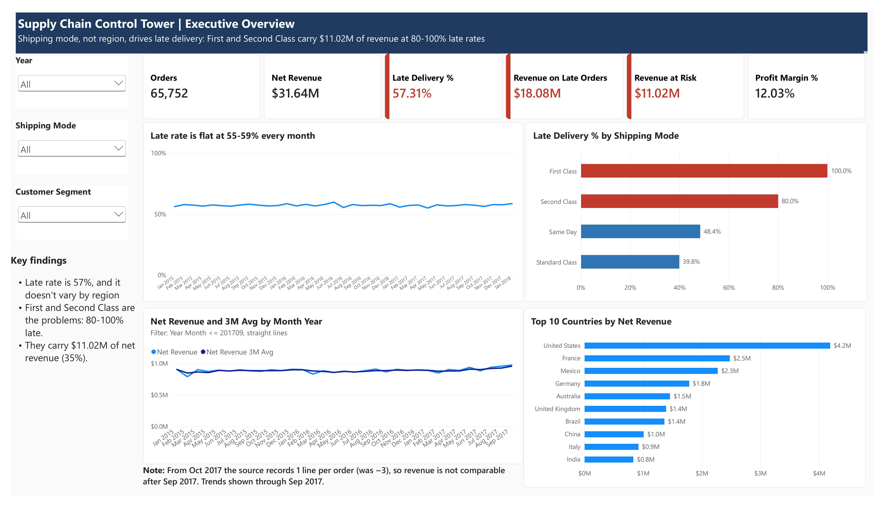
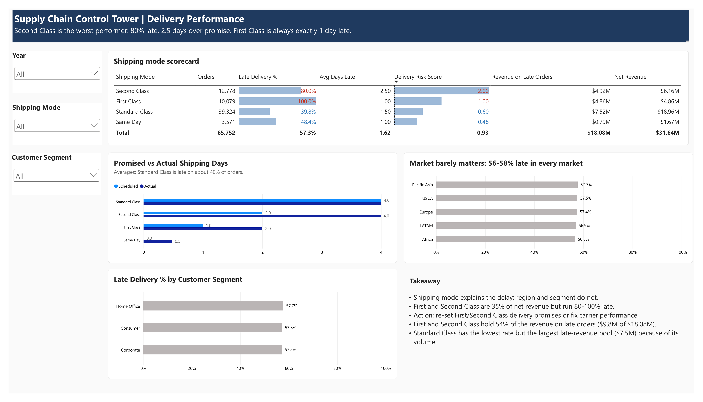

# Supply Chain Control Tower (Power BI)

A four-page Power BI report on 65,752 orders (180,519 order lines) from a public supply chain dataset. It shows where late deliveries come from and how much revenue they touch.

**Headline finding:** shipping mode, not region, drives late delivery. First Class and Second Class are 35% of net revenue ($11.0M of $31.6M) but 54% of the revenue on late orders ($9.8M of $18.1M).

## What the report shows

| Page | Question it answers | Main visuals |
| --- | --- | --- |
| Executive Overview | How bad is late delivery, and where is the revenue exposed? | Six KPI cards, late rate by month, late rate by shipping mode, revenue trend, top countries |
| Delivery Performance | Which shipping modes and groups drive lateness? | Shipping mode scorecard, promised vs actual days, late rate by market and customer segment |
| Products & Customer Segments | Is revenue or margin concentrated? | Top categories and products, revenue vs margin by product, customer segment shares |
| Findings & Recommendations | What should be done? | Written findings, actions, and a what-if on improving First and Second Class |

## Key findings

1. **Shipping mode drives lateness.** First Class is 100% late (always by exactly 1 day). Second Class is 80% late, 2.5 days over the promise. Standard Class is 40% late but holds 60% of revenue.
2. **Region and segment do not.** Every market and customer segment sits at 56-58% late.
3. **The risk is concentrated.** Revenue in shipping modes above the overall late rate is $11.0M.
4. **Revenue is concentrated, margin is not.** Ten of 118 products make 90% of net revenue. Margin is about 12% and discount about 10% where the revenue is. Products under 5% margin total $104K (0.3% of revenue).
5. **Margin lost to lateness is small** (an estimate of about $82K), so the case for fixing it rests on revenue exposure and customer experience.
6. **What-if:** cutting late deliveries on First and Second Class by 50% would lower the share of revenue on late orders from 57.1% to 41.7%.

## Data model

A star schema with one fact table at order-line grain.

| Table | Rows | Role |
| --- | --- | --- |
| `Fact_OrderItems` | 180,519 | One row per order line |
| `Dim_Customer` | 20,652 | Customer and segment |
| `Dim_Product` | 118 | Product, category, department |
| `Dim_ShippingMode` | 4 | Shipping mode |
| `Dim_Geography` | | Order destination (market, region, country, state, city) |
| `Dim_Date` | 1,461 | Marked date table, 2015-2018 |

Order metrics use `DISTINCTCOUNT` of `Order Id`, because an order can have several lines. Dimensions filter the fact table in one direction.

**Main DAX measures:** Orders, Valid Orders, Late Delivery %, Avg Days Late, Net Revenue, Profit Margin %, Discount %, Revenue on Late Orders, Revenue at Risk, Delivery Risk Score (late % x average days late), Customer Segment Contribution %, and time-intelligence measures (prior year, year to date, three-month average).

## Data preparation (Power Query)

- Read the CSV with Windows-1252 encoding to fix accented characters.
- Translated 102 Spanish country names to English with a lookup record.
- Trimmed text and fixed double spaces in region names.
- Excluded cancelled and suspected-fraud lines from net revenue, profit and delivery metrics, and show them separately.
- Dropped 16 of the 53 source columns: duplicates, personal data (names, email, street, password), and latitude and longitude, which did not match the customer city fields.
- Checked the data dictionary against the data. It describes `Order Item Total` as per order, but it is per order line.

## Data note

From October 2017 the source records one line per order instead of about three, so revenue and line counts are not comparable after September 2017. Revenue trends are shown through September 2017. Delivery metrics use all months, and the late rate stays at 55-59% throughout.

## Opening the report

1. Download the data from Mendeley (link below).
2. Open `report/SupplyChainControlTower.pbix` in Power BI Desktop.
3. To refresh, go to Transform data > Manage parameters and set `DataFilePath` to your copy of `DataCoSupplyChainDataset.csv`.

The raw data is not stored in this repository.

## Source

Constante, F., Silva, F., & Pereira, A. (2019). *DataCo SMART SUPPLY CHAIN FOR BIG DATA ANALYSIS* (Version 5). Mendeley Data. https://doi.org/10.17632/8gx2fvg2k6.5

Licensed under [CC BY 4.0](https://creativecommons.org/licenses/by/4.0/). Data cleaned and place names translated to English for this report. `docs/DescriptionDataCoSupplyChain.csv` is the data dictionary that came with the download.

Built by Jocelyne Horanituze.
